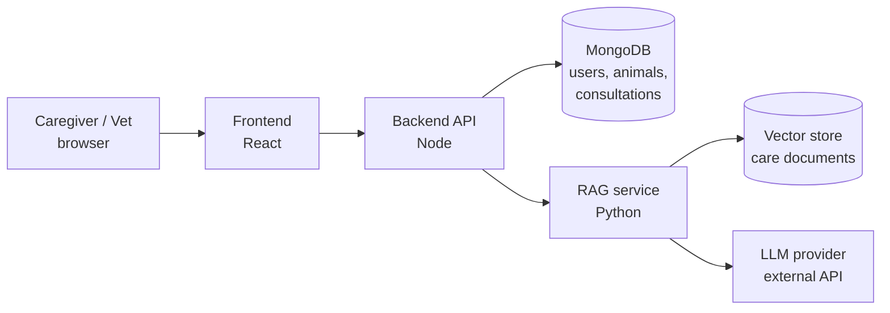

# System architecture — v1

- Status: Draft (v1)
- Date: 2026-10-17
- Related: ADR-0001, docs/requirements/, docs/data-model/

## Containers



| Container    | Tech               | Responsibility                                                           |
| ------------ | ------------------ | ------------------------------------------------------------------------ |
| Frontend     | React + TypeScript | What caregivers, vets and admins see                                     |
| Backend API  | Node + TypeScript  | Auth, roles, business rules (claiming, verification), single entry point |
| MongoDB      | MongoDB            | Users, animals, posts, consultations, messages                           |
| RAG service  | Python             | Answers care questions using trusted documents                           |
| Vector store | TBD (Phase 2)      | Care documents stored as embeddings                                      |
| LLM provider | External API       | Generates answers from retrieved documents                               |

## Key decisions

1. **The backend is the only entry point (API gateway).** The frontend never calls the RAG service directly. Login checks, rate limits on AI questions (cost protection) and saving Q&A all happen in one place.
2. **Only the backend reads and writes MongoDB.** The RAG service owns only its vector store. This protects us from breaking changes when the data model changes.
3. **The backend enriches RAG requests with context.** Example contract:

```json
   POST /ask
   { "question": "...", "animal": { "species": "cat", "approxAge": "3 years" }, "recentHistory": ["..."] }
```

4. **Data minimisation.** No caregiver personal information (name, phone, location) is sent to the RAG service or the LLM provider.

## Open questions

- Personal info typed into the question text itself (e.g. a phone number): scrub it before calling the LLM?
- What does the app show if the RAG service or LLM provider is down?
- Non-functional requirements (speed, low bandwidth, availability): v2.
