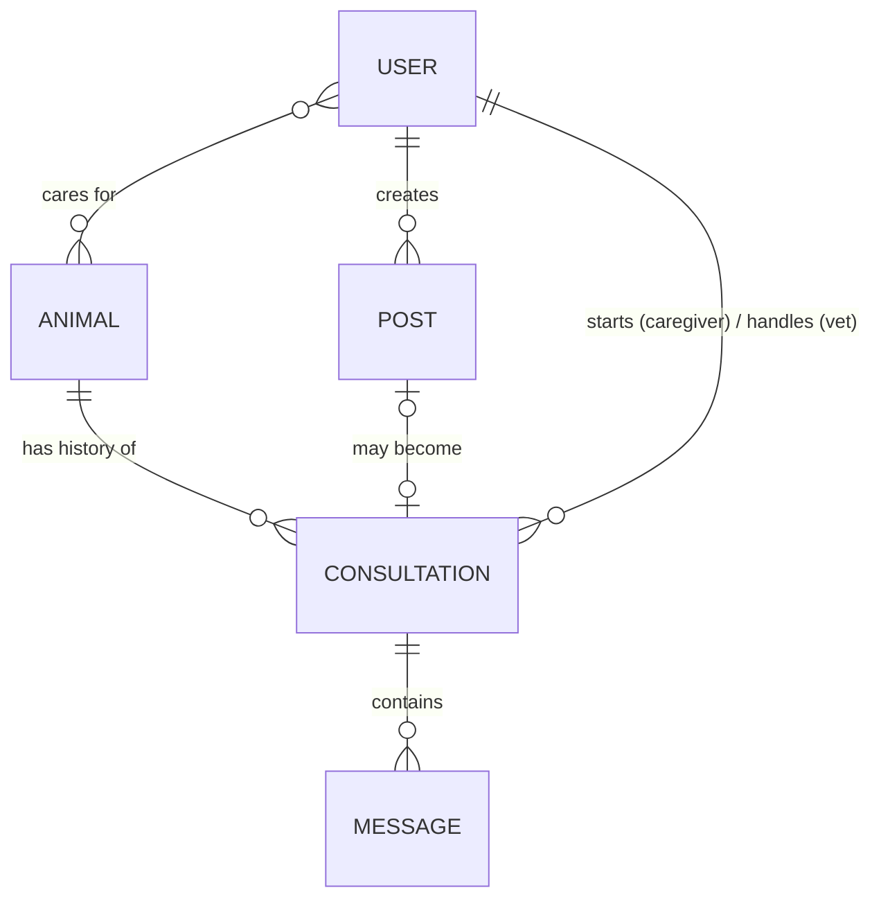

# Data model — v1

- Status: Draft (v1)
- Date: 2026-10-16
- Related: docs/requirements/README.md, ADR-0001

## Overview

## Collections

### User

| Field      | Type   | Notes                                                    |
| ---------- | ------ | -------------------------------------------------------- |
| name       | string |                                                          |
| email      | string | unique                                                   |
| role       | enum   | `caregiver` \| `vet` \| `admin` (field volunteer: later) |
| vetProfile | object | only for vets (see below)                                |
| createdAt  | date   |                                                          |

**vetProfile:** licenseNumber, licenseExpiry, degree, specialties[], animalsTreated[], status (`PENDING` \| `VERIFIED` \| `REJECTED` \| `EXPIRED` \| `SUSPENDED`), verifiedBy, verifiedAt

### Animal

| Field        | Type       | Notes                                              |
| ------------ | ---------- | -------------------------------------------------- |
| name         | string     | optional (street animals may have no name)         |
| species      | string     | e.g. dog, cat, rabbit                              |
| description  | string     | e.g. "brown dog, ~2 yrs, near MG Road"             |
| caregiverIds | ObjectId[] | optional; array so several feeders can share later |
| createdAt    | date       |                                                    |

### Post (help request)

| Field          | Type                    | Notes                                                           |
| -------------- | ----------------------- | --------------------------------------------------------------- |
| createdBy      | ObjectId → User         | the caregiver                                                   |
| animalId       | ObjectId → Animal       |                                                                 |
| description    | string                  |                                                                 |
| symptoms       | string[]                | structured answers used for urgency                             |
| urgency        | enum                    | `EMERGENCY` \| `URGENT` \| `ROUTINE`                            |
| status         | enum                    | `OPEN` \| `CLAIMED` \| `CLOSED`                                 |
| claimedBy      | ObjectId → User         | null when unclaimed (atomic claim: filter on `claimedBy: null`) |
| remindersSent  | number                  | for the claim timeout flow                                      |
| consultationId | ObjectId → Consultation | set once claimed                                                |
| createdAt      | date                    |                                                                 |

### Consultation

| Field               | Type              | Notes                                                    |
| ------------------- | ----------------- | -------------------------------------------------------- |
| caregiverId         | ObjectId → User   | who asked for help (always set)                          |
| vetId               | ObjectId → User   | current vet; changes on reassignment                     |
| animalId            | ObjectId → Animal | builds the animal's history                              |
| postId              | ObjectId → Post   | only if it started from a post                           |
| source              | enum              | `SEARCH` \| `POST`                                       |
| status              | enum              | `ACTIVE` \| `CLOSED`                                     |
| vetHistory          | array             | `{ vetId, from, to, reason }`, a record of reassignments |
| createdAt, closedAt | date              |                                                          |

### Message

| Field          | Type                    | Notes                                      |
| -------------- | ----------------------- | ------------------------------------------ |
| consultationId | ObjectId → Consultation | groups messages; survives vet reassignment |
| senderId       | ObjectId → User         |                                            |
| text           | string                  |                                            |
| createdAt      | date                    |                                            |

## Design notes

- **Messages are a separate collection, not embedded in Consultation.** A chat can grow without limit, and MongoDB documents have a size limit.
- **Animal history is not stored separately.** It's a query: all consultations where `animalId` = X.
- **RAG data** lives in the `rag/` service (Phase 2), not here.

## Open questions

- Duplicate animals: two feeders may create separate records for the same street dog. Demo: accept duplicates. Later: a "share animal" button, then photo + location matching.
- Search-started consultation where the vet never replies: offer "post this to all vets instead"?
- Emergency cases: what the app shows when no vet may reply in time (from requirements v1).
